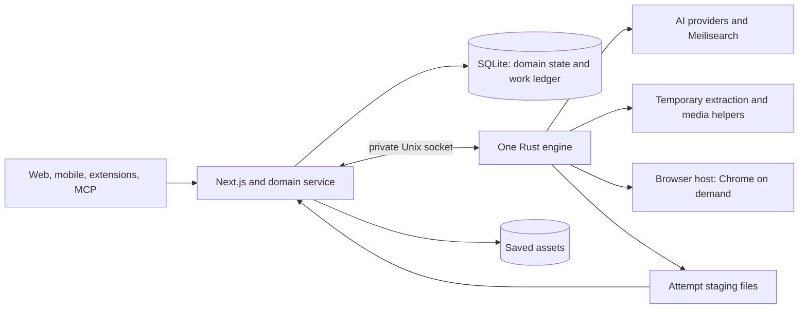

# Rust background engine

The fork runs one Rust execution engine alongside the Next.js application. The
application owns authentication, public APIs, domain rules, database writes and
asset publication. Rust owns network requests, inference, document processing
and search publication. Mobile apps, extensions, API clients and MCP clients use
the existing public API.

## Process and storage boundaries



`work_jobs`, `work_settings` and `extracted_documents` live in the main database.
Database triggers capture domain mutations in the same transaction as the
mutation, even if the process exits before its JavaScript enqueue call. The
legacy queue API remains an adapter for explicit recrawls and other producers.
Notifications reduce latency; SQLite remains the source of truth.

The application serves a private Unix socket at `DATA_DIR/engine.sock`, mode
`0600`. The engine claims compatible work, renews a 120-second lease every 30
seconds, and returns a result with its job ID and lease token. The socket is not
an additional public API. Prepared inputs and results use protocol version 1;
the Zod definitions in `packages/shared-server/src/work/contracts.ts` are also
recorded in `apps/engine/protocol-v1.json`.

At idle, the engine waits for up to 30 seconds on one claim request. The default
global concurrency is four tasks, with one crawler, two AI calls and separate
bounded limits for other work. These are async tasks in one process. No resident
Node background worker, per-queue process, Redis or queue database is needed in
Rust mode.

## Work and document flow

1. Saving or editing a bookmark commits a durable domain event. The application
   expands it into the required processing, rule and publication work.
2. The application prepares a snapshot with user preferences, prompts, input
   files, a content fingerprint and an attempt-specific staging directory.
3. Rust fetches HTTP content first. Readability, metadata extraction and HTML
   sanitization run in a temporary Node helper. Rendering runs only when policy
   requires it, through a separate temporary Patchright helper.
4. The resulting extracted document contains plain text, metadata, readability
   assessment, sanitized reader HTML and a reference to the original HTML.
   Inference and search reuse the same text. Existing documents are populated
   lazily when processing or retrieval needs them.
5. Rust calls Chat Completions and Embeddings directly. Paid results are
   checkpointed before application, so a publication retry can reuse them.
   Meilisearch tasks are awaited and checkpointed independently.
6. The application checks the lease and fingerprint, validates staged paths,
   publishes assets, and commits the domain result, completion and follow-up
   jobs together. Human tags survive inferred-tag replacement.

PDF extraction uses Poppler, image OCR uses Tesseract or the configured vision
model, video uses a bounded yt-dlp child, and full-page archives use Monolith.
Rust handles RSS/Atom parsing, webhooks and ZIP compression. Imports, rules,
export serialization and maintenance retain the existing TypeScript domain
models and run as bounded operations inside the application service.

Chrome has a separate small Rust control process. A crawl acquires a browser
lease; Chrome and its forwarding process start on acquisition and exit after
the last lease plus the idle window. Expired leases recover after engine death.
Neither browser debugging nor control ports are published on the host.

## Recovery guarantees

- Pending work coalesces by intent. Work submitted during an active attempt
  remains a pending successor rather than being lost when the attempt finishes.
- Work for the same subject is serialized, including search deletion. Deleted
  bookmarks retain tombstone work until their search documents are removed.
- Expired leases are reclaimed with a fresh token. Late tokens and changed
  fingerprints cannot overwrite current state. Completion acknowledgements can
  be replayed without applying a result twice.
- Failures use bounded exponential backoff. Terminal failures update the public
  processing status fields, so clients do not show a permanent pending state.
- Cancellation kills entire helper process groups. Staging and old job history
  are cleaned by delayed maintenance work.

Execution is at least once. A provider response followed by a crash before its
checkpoint can repeat the request. Webhooks include an `Idempotency-Key`, but
the receiver must honor it to prevent duplicate effects. SQLite and filesystem
publication are not one transaction: staged files remain available for replay,
and abandoned engine assets are cleaned after a grace period.

## Source map for future development

| Area | Location |
| --- | --- |
| Scheduler, native execution, browser host | `apps/engine/src/` |
| Protocol and work ledger | `packages/shared-server/src/work/` |
| Domain snapshots and follow-up work | `packages/trpc/services/processing/model.ts` |
| Prepared inputs and prompt construction | `packages/trpc/services/processing/prepare.ts` |
| Result validation and application | `packages/trpc/services/processing/apply.ts` |
| Feed, import, export, rule and maintenance operations | `packages/trpc/services/processing/operations.ts` |
| Unix socket service and startup recovery | `packages/trpc/services/processing/server.ts` |
| Additive schema and transactional mutation events | `packages/db/drizzle/0096_rust_engine.sql` |
| Temporary HTML and rendering helpers | `apps/workers/scripts/` |
| Contract integration tests | `packages/e2e_tests/tests/workers/engine.test.ts` |
| Production Compose and host handoff | `docker/briq/` |

For a user-facing feature, keep domain mutations in the application. Extend the
prepared input/result contract only when execution needs new capabilities. Add
a durable follow-up intent in the transaction that creates the need for work.
Avoid importing Node inference, tokenizer or browser runtimes into permanent
application startup. Keep fork changes on the customization branch and merge
upstream changes deliberately, especially schema and worker changes.

## Configuration and development

The production Compose file selects `KARAKEEP_ENGINE=rust`. The legacy worker is
still built for compatibility but does not run in this mode. The native engine
is Linux-oriented and ships in the application image; run it through Docker on
macOS. Use separate development databases, assets, indexes and credentials.

| Setting | Default | Purpose |
| --- | --- | --- |
| `KARAKEEP_ENGINE_CONCURRENCY` | `4` | Total concurrent execution tasks |
| `CRAWLER_NUM_WORKERS` | `1` | Concurrent crawl tasks |
| `CRAWLER_RENDER_POLICY` | `auto` | `auto`, `always` or `never` browser rendering |
| `BROWSER_CONTROL_URL` | Compose internal address | Demand-driven browser control |
| `KARAKEEP_BROWSER_IDLE_SECS` | `60` | Chrome idle reuse window |
| `KARAKEEP_BROWSER_LEASE_SECS` | `300` | Abandoned browser lease lifetime |
| `KARAKEEP_WORK_SOCKET` | `DATA_DIR/engine.sock` | Private application socket |

Existing model, prompt, provider, proxy, asset-size and processing timeout
settings are prepared by the application or read by the native executor. The
configured deployment uses SQLite, filesystem assets, OpenAI and Meilisearch.
Alternative queue backends are bypassed in Rust mode. Provider-specific options
and unusual proxy setups need their own integration coverage before adoption.

From the repository root, after installing the normal workspace dependencies:

```sh
cargo test --manifest-path apps/engine/Cargo.toml
cargo clippy --manifest-path apps/engine/Cargo.toml --all-targets -- -D warnings
pnpm --filter @karakeep/shared-server test --run
pnpm --filter @karakeep/trpc test --run
docker build --target aio -f docker/Dockerfile -t karakeep-engine:test .
docker build --target browser -f docker/Dockerfile -t karakeep-browser:e2e .
python3 apps/engine/tests/browser_lifecycle.py karakeep-browser:e2e
cd packages/e2e_tests
KARAKEEP_TEST_IMAGE=karakeep-engine:test E2E_TEST_NO_BUILD=1 pnpm exec vitest run tests/workers tests/api tests/assetdb
KARAKEEP_TEST_IMAGE=karakeep-engine:test E2E_TEST_NO_BUILD=1 pnpm test:engine-recovery
```

The integration suite creates a disposable Docker project with synthetic users,
mock AI, a search instance and object storage. It never mounts production data.
The browser lifecycle test also uses a disposable container.
The recovery command intentionally stops and kills the shared test executor;
run it separately from the parallel compatibility suite. Use unique image
tags during iterative verification, and wait for each build to finish before
starting a suite. Runtime files, backups and operational measurements stay
outside the source checkout.

## Deployment and rollback

Build and operate with `docker/briq/manage.sh`; both application and browser
images receive the same revision/timestamp tag. Building selects images but
does not replace running containers. See the host README for commands.

Before cutover, pause application writes, take a consistent copy of the complete
data directory, search data and private configuration, and retain the old image
selection and Compose file. Verify SQLite integrity on an isolated restore.
Migration 0096 is additive; outstanding legacy jobs are imported once using
durable markers. Original legacy queue rows remain available for recovery.

For rollback, stop the new application and restore the previous **application
and Chrome image configuration together**. Disable mutation capture by setting
`work_settings.enabled` to `0` while the application is stopped. Preserve the
current data when possible: restoring an old database also discards bookmarks
saved since that backup. Outstanding Rust-ledger work does not automatically
transfer back to the legacy queue; drain it first or explicitly requeue the
required processing through the old application. Selecting the legacy worker
alone is insufficient because it expects an always-running browser.

The extracted-document table and internal work tables can remain in the
database during rollback. Original HTML uses the existing `userUploaded` asset
type, so older applications can still read the asset records. A rollback image
must remain compatible with the pre-existing application schema as well.
